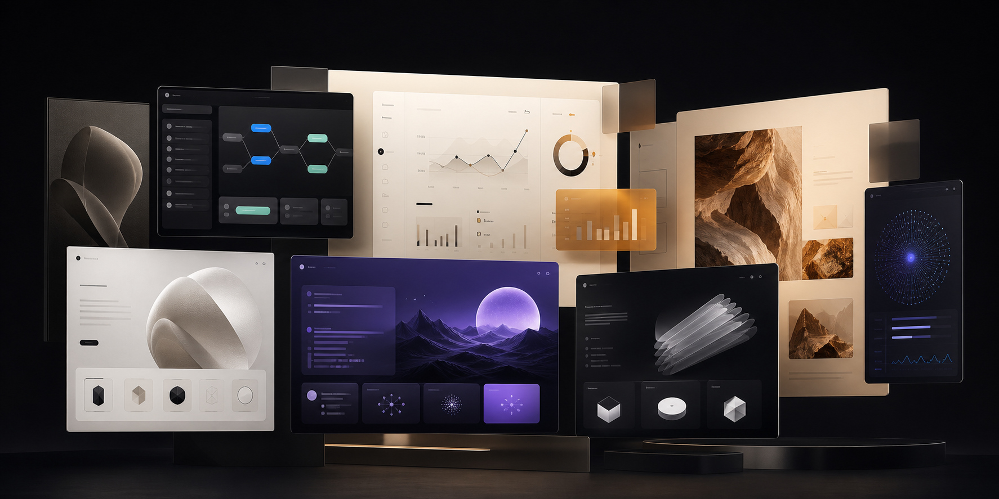

# Drew Sepeczi — Product Engineering & Interface Marketplace



A living collection of useful software, expressive interfaces, and launch-ready website templates. The site brings Drew's shipped products together with a growing library of design studies that visitors can explore in the browser and use as the foundation for their own ideas.

## Explore the work

The portfolio opens with products that are already out in the world: AI-powered SaaS, developer tools, workflow software, APIs, and design systems. Animated previews offer a quick sense of each product before linking out to the full experience.

The collection then moves from finished products into reusable design work, with two ways to find a starting point for a new site.

## Hero components

The hero collection is a series of focused interface studies. Each one explores a distinct visual identity, product story, and first impression—from quiet wellness experiences and precise analytics dashboards to cinematic AI infrastructure and energetic automation platforms.

Every concept can be opened as a full responsive preview, making it easy to experience the typography, spacing, motion, and hierarchy as they were intended. These are designed for teams that already have a site but want a stronger opening statement without rebuilding everything around it.

The current collection includes:

- **Equilibrium** — A calm, immersive wellness experience for a steadier everyday life.
- **Palomar** — A crisp, technical introduction to a unified system for LLMs.
- **Axon** — A bold automation concept centered on digital workers and repetitive workflows.
- **Vesper** — A cinematic vision of operational AI infrastructure.
- **Nexora** — A polished automation interface that turns busywork into forward motion.
- **The Next Layer of Intelligence** — A dramatic foundation for products scaling complex AI systems.
- **Convix Software** — A sharp, editorial direction for the future of PR agency operations.
- **Vantage** — A clear, confident way to tell a product story across fragmented dashboards.
- **Meridian** — A refined revenue-intelligence experience built for modern SaaS teams.

## Complete templates

The complete templates expand that same level of art direction into full product stories. Each experience is built to carry a visitor from the first headline through features, proof, use cases, pricing, questions, and a final call to action. They are meant for founders and teams who want more than a beautiful hero—they want a cohesive site with enough depth to launch.

- **Infranex** pairs a dark, cinematic aesthetic with a complete AI task-management journey. Its layered product visuals and focused conversion flow suit tools that need to make sophisticated technology feel immediate and understandable.
- **Salix** uses warm, confident storytelling for a sales SaaS product. Analytics, workflow features, customer proof, and pricing come together in a layout that feels established without becoming corporate.
- **DreamMotion** is an image-rich home for an AI creative platform. Galleries, motion, process storytelling, testimonials, and interactive moments give visual work the space to feel genuinely alive.
- **AgentLab** presents an expansive automation platform through workflows, measurable outcomes, industries, security, and proof. It is designed for products that need to communicate both ambition and operational credibility.
- **Fusion AI** combines energetic motion, product demonstrations, integrations, social proof, and conversion sections into a polished story for modern AI workflow tools.

Each template can be previewed directly on the site before purchase. The goal is simple: make it easier to begin with a distinctive, considered experience instead of another generic landing-page shell.

## Built by Drew

Drew is a Chicago-based product engineer who works from early product decisions through production. The collection reflects that approach: strong visual ideas grounded in clear workflows, responsive behavior, and software people can confidently use and own.

The site is also an open invitation to collaborate—whether that means shaping a new product, improving an existing experience, or turning an ambitious idea into something real.

## Run locally

```bash
pnpm install
pnpm dev
```

Open [http://localhost:3000](http://localhost:3000) to explore the collection.
